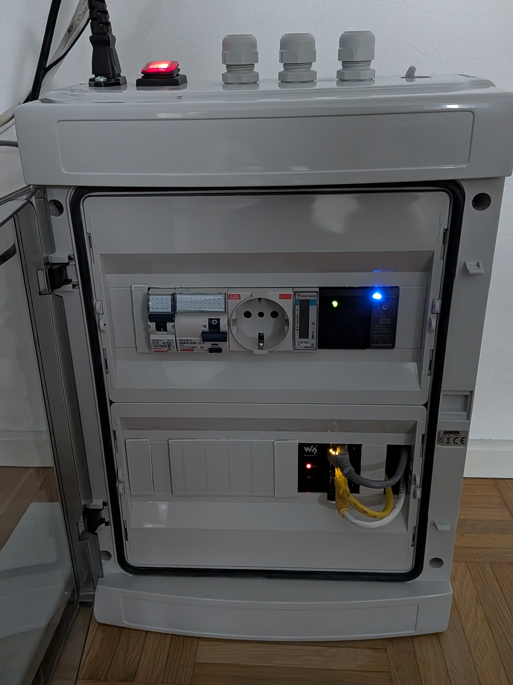
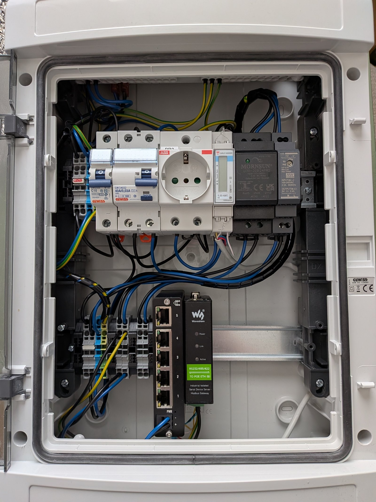

*[Suomeksi](README.md) · **English** · [Work diary](NOTES.md)*

# Iot test cabinet, multi-protocol environment for industrial IoT

A test cabinet has been installed in the field to collect data from fieldbuses.
I use the MQTT protocol for data collection and TypeScript for pushing it into databases.

The cabinet is later meant to be able to simulate faults that occur in the field.

<table>
  <tr>
    <td></td>
    <td></td>
  </tr>
</table>

## Why this exists

The purpose is to deepen my knowledge of industrial communication protocols and
devices, and to learn to build things at the code level. I also aim to document
every consideration, decision, fault and action.

Background: electrician, with IoT/cloud still to be learned.

## What is different here

Most hobby projects demo the path that works. This one deliberately also demos
the path that **fails**:

- A physical fault-injection panel (switch rail: A/B swapped, termination
  resistor disconnected, common ground broken...)
- Software simulation of network faults (`tc netem`) and cross-testing against
  a real mobile network
- Every reading carries an OPC UA -style quality field
  (`GOOD` / `UNCERTAIN` / `BAD` + substatus), not just a value
- Every architecture decision is recorded as an ADR, together with the
  alternatives that were rejected.

## Architecture

```
Field                     Edge                          Cloud
─────                     ────                          ─────
Modbus meter ───RS485───┐
                        │
                        └─► Waveshare ──Eth──┐
                                             │
                                          TSW010 ──Eth──► ZTE (SIM)
                                             │                │
                                             │                4G
ESP32 (CN105) ──  WiFi (Pi:n oma AP)──►  Pi 4B                ▼
                                                        broker + database
                                                        Mosquitto
                                                        InfluxDB, MongoDB
                                                        store-and-forward
```

The diagram shows the target. For now the broker and databases run on the
Pi (ADR-0001), and the move to the cloud gets its own ADR.

Layers: **driver → normalization → quality gate → buffer → publish.**

The TSW010 is an unmanaged switch, so link state is not readable in
software: a pulled gateway cable shows up only as a failed Modbus
connection.

## Protocols covered

| Protocol | Role in this project | Status |
|---|---|---|
| Modbus RTU | Energy meter, RS-485 sensor | 🟡 |
| Modbus TCP | Waveshare gateway | 🟡 |
| M-Bus | Separate meter, own parser | ⚪ |
| wM-Bus | 868 MHz, own meters only | ⚪ |
| CN105 | Reading heat pump state | ⚪ |
| 1-Wire | Temperature watchdog | ⚪ |
| Analog | Current clamp | ⚪ |
| S0 pulse | Fallback route | ⚪ |
| LoRa (P2P) | Radio link | ⚪ |
| MQTT | The entire internal message bus | ⚪ |

🟢 implemented in the pipeline · 🟡 verified on the bench, no pipeline code ·
⚪ planned

No protocol is implemented in the pipeline yet: `src/` currently contains
the config loader with its tests, no driver yet. Modbus RTU and TCP are bench-verified (every EM111
register read through the Waveshare gateway).

## Structure

```
docs/
  adr/                ← architecture decisions, one file per decision
  design/             ← feature specs (requirements, design, tasks)
  vikaluettelo.md     ← observed and injected faults, metrics
  images/             ← README images
config/
  gateways/           ← one file per gateway
  profiles/           ← one register map per meter model
src/                  ← drivers, pipeline (TypeScript)
tests/                ← vitest tests and their fixtures
hardware/             ← one folder per device: records and manufacturer documents
```

## Running locally

Requires Node.js 24.

```bash
npm ci                  # install dependencies
npm run build           # compile TypeScript
npm test                # run the tests
npm start               # build and start, loads and validates the configs
```

`start` reads its environment variables from `.env.development`.

## Environment variables

Copy `.env.example` to `.env.development` and fill in the values.

| Variable | Required | Description |
|---|---|---|
| `CONFIG_DIR` | yes | Root folder of field configuration: contains `gateways/` and `profiles/` |
| `ENV` | no | `development` (default), `testing` or `production` |

## Architecture decisions

Every significant choice and every rejected alternative is recorded as an ADR:
context, alternatives, decision, consequences, verification.

→ [`docs/adr/`](docs/adr/README.md): index and all decisions

## Fault log

⚪

## Status and roadmap

- [ ] Design and device selection, ADR-0001…0021
- [ ] Modbus chain on the bench (meter → Waveshare → database)
- [x] Enclosure
- [ ] Fault-injection panel
- [ ] CN105 readout from the air-source heat pump (read-only)
- [ ] Commissioning of the remote site
- [ ] Replay mode for the demo

## Author

Jarmo T a background in electrical installation, learning the IoT/cloud side
through this project.

## License

MIT [`LICENSE`](LICENSE)
