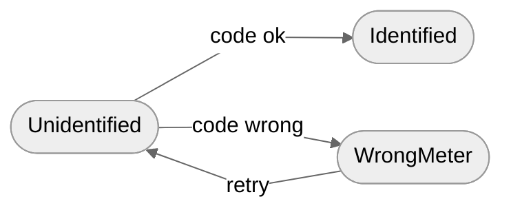
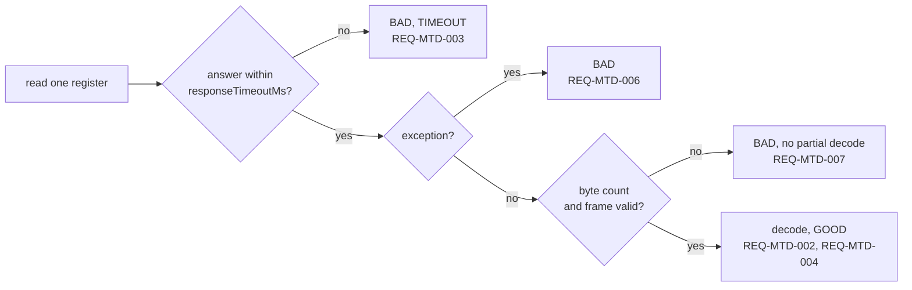
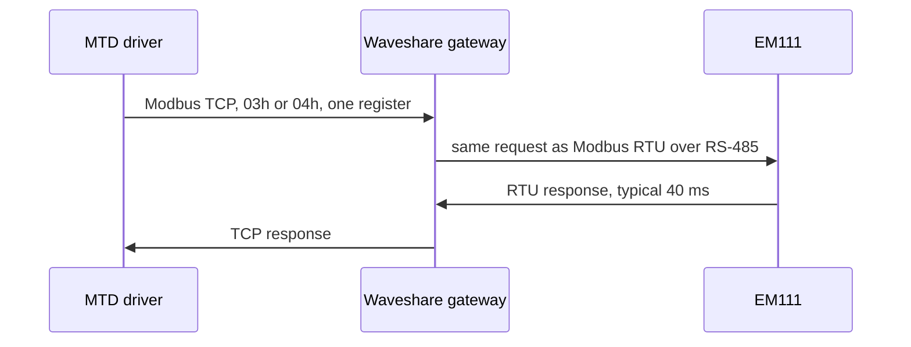

# Modbus TCP driver: Technical Design

- **Related:** requirements.md, pseudo.md, ADR-0004 (draft), ADR-0020, ADR-0010
  (superseded, context only), ADR-0003

### LOG
- Log is for tracking requirements implementation from requirements.md

1. Starting Requirements REQ-MTD-001 -- 15.9.26

## Components

| Component | Owns | Does not own |
|---|---|---|
| `scheduler` | The cycle clock: the configured polling interval, when the next cycle is due, and starting exactly one cycle at a time. | Error handling, Modbus protocol, connection state |
| `connection` | Opening and closing the TCP connection, a new attempt each cycle while it is down, and identifying each meter until it passes (D7). | The cycle clock, reading measurement registers |
| `registerReader` | One request for one register (D5), the response timeout (D2), and classifying the outcome: answer, timeout, exception or malformed. | Decoding, quality per reading, the connection's life |
| `decoder` | Raw words to a number: word order, `type`, `scale` (D6). A pure function, testable without hardware. | Anything on the wire |

| REQ | Component |
|---|---|
| 001, 010 | `scheduler` |
| 008, 010, 011, 012 | `connection` |
| 003, 006, 007 | `registerReader` |
| 004 | `decoder` |
| 002, 005, 009 | The cycle `scheduler` starts: one reading per register, quality per register |

Each component is a separate unit so that each can be tested on its own.
Connection and register reading are split the way Home Assistant splits its
modbus hub from its entities.

`scheduler` serves REQ-MTD-001 and REQ-MTD-010. It holds the next due time and
no previous readings. That absence is deliberate: remembering values is what
`STALE` detection needs, and ADR-0004 gives `STALE` to the quality gate.

The connection belongs elsewhere, but REQ-MTD-010 pins what its state does to
the clock: nothing. A dead gateway neither stops nor resets the cycle, the next
cycle retries on its own, and a returning gateway needs no restart.

One cycle at a time is a constraint, not a preference. ADR-0020 option A leaves
the gateway without queueing, so a second request while one is in flight
collides on the RS-485 bus. ADR-0020 names a second master as that case; an
overlapping cycle of our own is the same collision, by inference.

NFR-MTD-001 is the only measurable claim about `scheduler`, and its tolerance
has no source yet.


## Implementation considerations

### Modbus library

**Modbus client library.** Two maintained open source candidates, checked
against the npm registry and the downloads API on 2026-09-15. Chosen:
`modbus-serial` 8.0.25, installed 2026-09-17 and pinned by `save-exact=true`.
It carries roughly twice the downloads, and its optional `serialport` costs
nothing here because the RS-485 side belongs to the gateway.

| | `modbus-serial` | `jsmodbus` |
|---|---|---|
| Version | 8.0.25 | 5.0.0 |
| License | ISC | MIT |
| Downloads, 2026-09-05 to 09-11 | 37 849 | 16 133 |
| `serialport` | Optional dependency (`^13.0.0`) | Not a dependency (`crc`, `debug`, `commander`) |
| Repository | `yaacov/node-modbus-serial` | `Cloud-Automation/node-modbus` |

The `serialport` row matters only because `.npmrc` sets
`ignore-scripts=true`, so a native `serialport` would need `npm rebuild`.
Neither library forces it: `modbus-serial` keeps it optional, `jsmodbus` does
not pull it at all. MTD needs no serial port in any case. The RS-485 side of
the bus belongs to the gateway, and the Pi reaches it over Ethernet
(`README.md` topology).

What either library hands back above the wire is not settled here.
`modbus-serial` was noted earlier as returning raw 16-bit words, `jsmodbus`
has not been checked. REQ-MTD-004 puts word order, sign and the register
weight in this project's own code either way.

Other packages exist and were not compared.

### TypeScript

Both libraries ship their own declarations, so neither needs `@types`.
`jsmodbus` generates them from its TypeScript source, `modbus-serial` keeps a
hand-written `index.d.ts` that can drift from the implementation. Both are
CommonJS with no `exports` field, and this package is `"type": "module"`, so
import them as a default import.

`tsconfig.json` needs `"types": ["node"]` before the first timer is written.
TypeScript 6 changed the default to `[]`, and `setInterval` and `Buffer` come
from `@types/node`, not from `lib`. Untested: nothing here uses a Node global
yet, so `npm run typecheck` still passes.

## Sequence: one poll cycle

Simple mode, so every query reaches the meter and nothing is answered from a
cache (ADR-0020). Registers are read one at a time (`decisions/D5`). No
retry within a cycle (`decisions/D2`). Both are first-version choices with a
planned change recorded in the decision file.

The driver is one participant here. Its internal split is the Components
table, and `scheduler` appears only as what starts the cycle.

Three views, one concern each: the connection's life, one register read,
and the path a request takes.

### Connection life

Two levels: the connection belongs to the gateway, identification to each
meter. Each cycle the scheduler ticks, and what MTD emits depends on both.

**Gateway connection**


| State | Each cycle | REQ |
|---|---|---|
| Disconnected | Try to open. If the open fails, every register of every meter `BAD` | 008, 010 |
| Connected | Each meter acts on its own state below | |

**Each meter, while Connected**



| State | Each cycle | REQ |
|---|---|---|
| Unidentified | Read `000Bh`, `0302h`, `0303h`. Any read fails: every register of this meter `BAD`, stay | 011, 013 |
| Identified | One reading per register, see "One register read" | 002-007 |
| WrongMeter | Every register of this meter `BAD`, then retry identification | 012 |

Every meter starts Unidentified when the connection opens. A failed
firmware read fails the whole identification, even when the code matched.
One meter's failure never closes the connection, so the others keep
polling (D7).

### One register read



Quality is decided per register, one reading each (REQ-MTD-005,
REQ-MTD-009).

### Request path



## Data model / interface

Sketch, not the final `src/types/` file. The `Reading` envelope itself is
defined once in ADR-0004 and is not restated here; below is only what MTD
takes in, what it hands out, and which parts of the envelope it narrows.

### In: gateway config

`src/schemas/gateway/gatewaySchema.ts`, plus the two timing fields.

```ts
gateway = {
  name:              string
  id:                string
  ip:                ipv4
  port:              1-65535
  pollIntervalMs:    number   // D4, REQ-MTD-001
  responseTimeoutMs: number   // D4, D2, REQ-MTD-003
  slaves: [{
    slaveId: 1-247
    id:      string
    profile: string           // name of the profile file
    label:   string
  }]
}
```

Both timings sit on the gateway, not on a slave: one bus, one cycle clock.

### In: profile

`src/schemas/profile/profileSchema.ts`, without `signed` and with the
identification code.

```ts
profile = {
  name:               string
  identificationCode: number  // D7, REQ-MTD-012
  wordOrder:          'lowFirst' | 'highFirst'
  registers: [{
    id:    string             // becomes the reading's point
    unit:  string
    adr:   0-65535
    count: number             // words, D5
    type:  'int16' | 'uint16' | 'int32' | 'uint32'  // D6, carries the sign
    scale: number             // D6, REQ-MTD-004
  }]
}
```

The list order is the read order within a cycle.

### Inside: `registerReader` outcome

A discriminated union. The driver turns each `kind` into a `Reading`, so
these Modbus terms never leave the driver.

```ts
outcome =
  | { kind: 'answer';    words: number[] }   // REQ-MTD-002
  | { kind: 'timeout' }                      // REQ-MTD-003
  | { kind: 'exception'; code: number }      // REQ-MTD-006, codes 01h-04h
  | { kind: 'malformed' }                    // REQ-MTD-007
```

`registerReader` takes the Modbus client as a parameter instead of creating
it, so tests can pass a fake client. Chosen over thrown errors (a missed
`catch` stops the cycle) and over a `{ ok, error }` result (the exception
case needs its own `code` field).


## Error handling and edge cases

### Connection timeout

Opening the connection uses `responseTimeoutMs`, the same limit as an answer.
`modbus-serial` 8.0.25 sets one socket timeout for both (`ports/tcpport.js`,
the `timeout` handler), and only if the client's `setTimeout` is called
before `connectTCP` (`apis/connection.js`). Without it an unreachable gateway
holds the cycle until the operating system gives up, against REQ-MTD-010.
A failed open is REQ-MTD-008: every register `BAD`, `value: null`.

### Connection lost mid-cycle

Cannot occur while a cycle is one request: the first version reads one
register (D5). `readBlock` exists alongside `readRegister` and is tested on
its own, but the cycle does not call it. Before a cycle makes more than one
request, REQ-MTD-005 and REQ-MTD-008 must be reconciled: REQ-008 marks every
register in the cycle `BAD` on a lost connection, REQ-005 keeps registers
that already answered `GOOD`.

## Testing strategy
Waiting for req 001
Which REQ is proven how. Unit tests for logic that needs no hardware, bench
tests for anything the wire decides. Prefer recorded values over invented
ones.

| REQ | Test | Where |
|---|---|---|
| REQ-n | ... | ... |

## Open questions

Anything still unresolved that shouldn't block writing this doc, but
should block marking it "Accepted".

- **Daisy-chain break.** Meters past a break in the RS-485 chain go silent
  while those before it answer, which reads as several meters dying. The
  gateway config lists slaves without chain order, so the data cannot tell
  the two apart.
- **Second Modbus client.** The gateway accepts up to 30 TCP connections and
  serves several hosts in its one-question-one-answer mode (Waveshare wiki).
  A request queued behind another client's traffic can exceed
  `responseTimeoutMs` and arrive as `TIMEOUT` with nothing broken. The
  gateway's `QueryOneAckOneMaxWait` parameter bears on this and has not
  been read.
